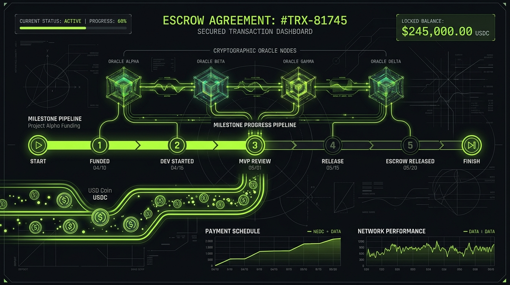
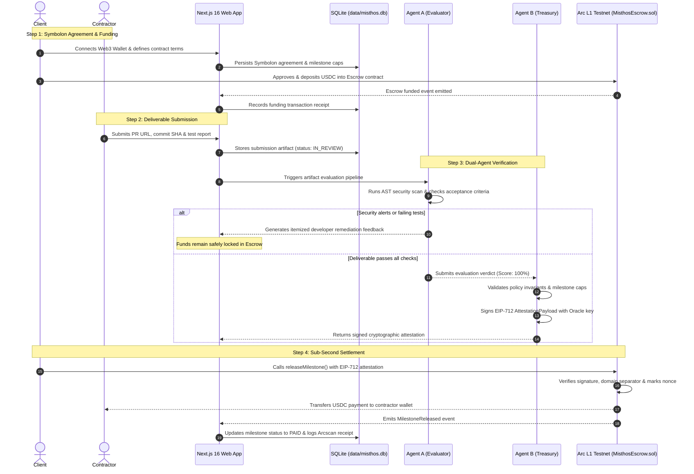
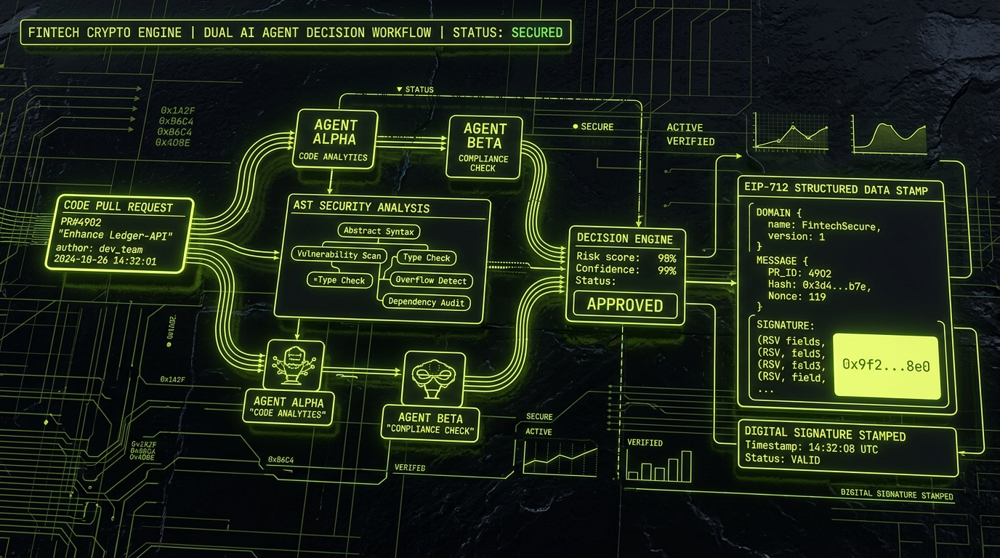

# MISTHOS (Μισθός)
### Verifiable Deliverable Oracle & Continuous Milestone Escrow on Arc Testnet

[](https://opensource.org/licenses/MIT)
[-C7F36B)](https://testnet.arcscan.app)
[-2775CA)](https://circle.com)
[-363636)](https://soliditylang.org/)
[-black)](https://nextjs.org/)

---



---

## 1. Executive Summary & Vision

**Misthos** (Greek for *wages* or *payment for earned work*) transforms contractor agreements from delayed, trust-dependent invoicing into **verifiable, programmable settlement on Circle's Arc Testnet**.

Built for the **Tameion Agents Hackathon**, Misthos unites autonomous AI evaluation agents with non-custodial smart contracts to eliminate invoice disputes, payment lag, and deliverable ambiguity. Clients fund milestones in native USDC; contractors submit deliverables (GitHub Pull Requests, commit hashes, test suite reports); dual AI agents verify acceptance criteria and AST security; and upon signed EIP-712 cryptographic attestation, payments are released with sub-second, low-cost Arc finality.

### The Byzantine Heritage & The Three Pillars

In Byzantium, the **Tameion** served as the imperial treasury, originating from the *vestiarion* to guard state wealth, mint coin, and execute auditable payments. Misthos extends this foundation into autonomous software:

```
                     ┌───────────────────────────────────────────────┐
                     │               1. THE SYMBOLON                 │
                     │  Mutual Agreement: Milestones, Criteria & Cap │
                     └──────────────────────┬────────────────────────┘
                                            │
                                            ▼
                     ┌───────────────────────────────────────────────┐
                     │                 2. THE ORACLE                 │
                     │   Agent A: Artifact Evaluation & Remediation  │
                     │   Agent B: Invariant & EIP-712 Signer Treasury│
                     └──────────────────────┬────────────────────────┘
                                            │ (Cryptographic EIP-712 Attestation)
                                            ▼
                     ┌───────────────────────────────────────────────┐
                     │                3. THE MISTHOS                 │
                     │ Non-Custodial Escrow Contract on Arc Testnet  │
                     │     Settles in native 6-decimal USDC          │
                     └───────────────────────────────────────────────┘
```

1. **The Symbolon (Σύμβολον):** The bilateral agreement defining milestones, acceptance criteria, evidence formats, and integer USDC payment caps.
2. **The Oracle:** An autonomous dual-agent evaluation pipeline that executes static code analysis, security checks, and criterion grading, issuing cryptographically signed EIP-712 attestations.
3. **The Misthos:** The decentralized smart escrow ([`contracts/MisthosEscrow.sol`](contracts/MisthosEscrow.sol)) deployed to Arc Testnet, enforcing hard on-chain invariants that prevent overpayment, replay attacks, and unauthorized state changes.

---

## 2. System Architecture & End-to-End Flow



---

## 3. Dual-Agent Decision Workflow



### Agent A: Artifact Evaluation Agent
- **Artifact Ingestion:** Inspects submitted pull request URLs, commit SHAs, test results, and source code.
- **AST Static Security Scanner:** Analyzes source code for dangerous patterns, including:
  - Hardcoded private keys and API credentials.
  - Arbitrary process execution (`child_process.exec`, `spawn`).
  - Path traversal and unauthorized file reads.
  - Suspicious outbound network exfiltration calls.
- **Criteria Verification:** Matches deliverables against frozen acceptance criteria agreed upon in the Symbolon.
- **Actionable Remediation Feedback:** If deliverables fail, Agent A generates structured, reproducible diagnostic guidance pointing out the failing test or security warning and explaining the exact steps required for resubmission.

### Agent B: Client Treasury Agent
- **Invariant Enforcement:** Ensures no payment can occur without:
  - 100% required automated test pass rate.
  - Zero high-severity security scanner alerts.
  - Release amount staying within the agreed milestone cap.
- **Cryptographic Attestation:** Computes the deliverable fingerprint, policy hash, and expiry timestamp, producing an **EIP-712 typed signature** over the structured `AttestationPayload`.

---

## 4. Live Arc Testnet Network Configuration

Misthos connects directly to Circle's Arc Layer-1 Testnet using native USDC:

| Parameter | Configuration Value | Reference |
| :--- | :--- | :--- |
| **Network Name** | Arc Testnet | Circle Layer-1 Testnet |
| **Chain ID** | `5042002` | `0x4CEFB2` |
| **Primary RPC** | `https://rpc.solidrpc.io/public/evm/5042002` | Public High-Performance RPC |
| **Fallback RPC 1** | `https://rpc.testnet.arc.network` | Official Arc Testnet RPC |
| **Fallback RPC 2** | `https://arc-node.thecanteenapp.com/` | Verified Community RPC |
| **Native USDC Address** | `0x3600000000000000000000000000000000000000` | Native 6-decimal USDC |
| **Block Explorer** | `https://testnet.arcscan.app` | Arcscan Explorer |
| **Settlement Currency** | USDC | Native gas & transfer token |
| **Financial Arithmetic** | Pure `BigInt` | **Zero JavaScript floating point arithmetic** |

---

## 5. Security Invariants & Exploit Defenses

The smart contract ([`contracts/MisthosEscrow.sol`](contracts/MisthosEscrow.sol)) enforces bytecode-level financial invariants:

1. **Non-Custodial Escrow Vault:**
   - Once the client deposits USDC, funds are locked in the smart contract. Neither party can unilaterally alter terms or seize funds.
2. **EIP-712 Cryptographic Attestation Verification:**
   - Milestone releases require an on-chain signature verification (`ECDSA.recover`) matching the authorized Oracle signer address:
   ```solidity
   struct AttestationPayload {
       bytes32 escrowId;
       uint256 milestoneId;
       bytes32 deliverableHash;
       bytes32 policyHash;
       uint8 decision;
       uint256 authorizedAmount;
       uint256 nonce;
       uint256 expiry;
   }
   ```
3. **Nonce-Based Replay Protection:**
   - Every attestation contains a unique `nonce`. Upon release, the contract marks `usedNonces[nonce] = true`. Replayed signatures are strictly reverted.
4. **Milestone Payout Caps:**
   - The contract verifies that `authorizedAmount <= milestone.amount` and that a milestone is never settled twice.
5. **Exact Decimal Base Units:**
   - All token values are handled strictly in 6-decimal integer base units (`BigInt(1000000)` = 1.000000 USDC).
6. **Pull-Payment Pattern:**
   - Funds are directed exclusively to the contractor address authorized at agreement creation.

---

## 6. Authentication: Direct Web3 Wallet Login & Email

Misthos provides dual-mode access control:

1. **1-Click Web3 Direct Wallet Login:**
   - Connect any EVM browser wallet (MetaMask, Rabby, Coinbase Wallet).
   - Sign an EIP-191 personal identity challenge.
   - The backend auto-creates your account profile (`Operator 0x...`) in SQLite, generates a session, and logs you into `/app` immediately without requiring email or passwords.
2. **Traditional Email/Password:**
   - Standard account registration using `bcryptjs` password hashing with 12 salt rounds and secure HttpOnly session cookies.

---

## 7. Repository Structure

```
d:/project/tresion/
├── contracts/
│   ├── MisthosEscrow.sol          # Main Escrow contract with EIP-712 attestation verification
│   └── MockUSDC.sol              # 6-decimal ERC-20 token interface for test suites
├── scripts/
│   ├── compile.js                # solc 0.8.24 compiler with viaIR optimizer
│   ├── deploy-arc.js             # Deployment script for Arc Testnet (RPC 5042002)
│   └── test-contracts.js         # Standalone local EVM contract runner
├── src/
│   ├── app/
│   │   ├── page.tsx              # Public homepage (Hero visual, live simulator, wallet CTA)
│   │   ├── layout.tsx            # Root layout with theme provider & wallet provider
│   │   ├── icon.svg              # Misthos custom SVG brand icon
│   │   ├── login/page.tsx        # Sign-in with Web3 wallet or credentials
│   │   ├── signup/page.tsx       # Onboarding page with 1-click wallet button
│   │   ├── app/                  # Protected Application Shell (/app)
│   │   │   ├── page.tsx          # Overview dashboard (financial reserves, locked escrow)
│   │   │   ├── contracts/page.tsx# Contracts list & status filter
│   │   │   ├── contracts/new/    # 5-step Symbolon contract creation wizard
│   │   │   ├── contracts/[id]/   # Contract escrow detail & deposit modal
│   │   │   ├── milestones/[id]/  # Deliverable submission, live Oracle console, payout button
│   │   │   ├── verification/     # Oracle audit logs and reports
│   │   │   ├── transactions/     # Arc settlement table with Arcscan explorer links
│   │   │   ├── activity/         # Immutable platform audit trail
│   │   │   └── settings/         # Wallet connector & profile preferences
│   │   └── api/                  # Secure backend routes
│   │       ├── auth/             # /login, /signup, /logout, /me, /wallet, /wallet-login
│   │       └── app/              # /overview, /contracts, /milestones, /transactions, /activity
│   ├── components/
│   │   ├── app-nav.tsx           # Sidebar navigation with Arc network status
│   │   ├── wallet-login-button.tsx # Reusable 1-click Web3 login button
│   │   ├── wallet-provider.tsx   # EIP-1193 browser wallet context (MetaMask, Arc switch)
│   │   ├── theme-provider.tsx    # Light/Dark mode state synchronization
│   │   └── theme-toggle.tsx      # Accessible theme switcher
│   └── lib/
│       ├── arc-config.ts         # Arc Testnet constants and integer USDC formatters
│       ├── auth.ts               # Session management and wallet login handler
│       ├── db.ts                 # SQLite schema initialization and connection
│       └── agents/
│           ├── evaluator-agent.ts# Agent A: PR evaluation, AST scanning, remediation
│           └── treasury-agent.ts # Agent B: Invariant checks & EIP-712 typed signing
├── test/
│   ├── run-contract-suite.mjs    # 9-step smart contract invariant verification
│   ├── agent-tests.mjs           # Dual-Agent evaluation and signature tests
│   ├── db-auth-tests.mjs         # Database persistence and password security tests
│   ├── e2e-api-flow.mjs          # Complete end-to-end HTTP API lifecycle test
│   └── wallet-auth-test.mjs      # Direct 1-click Web3 wallet login test
├── public/
│   ├── favicon.svg               # SVG brand favicon
│   └── images/
│       ├── misthos_hero_graphic.jpg  # Generated high-res escrow pipeline visual
│       └── misthos_oracle_engine.jpg # Generated high-res Dual-Agent workflow visual
├── data/
│   └── misthos.db                # Persistent SQLite database (WAL mode)
├── .env.example                  # Environment configuration template
├── .env.local                    # Local development configuration
└── package.json                  # Dependencies and execution scripts
```

---

## 8. Quickstart & Installation

### Prerequisites
- Node.js >= 18.0.0
- npm >= 9.0.0
- EVM browser wallet (e.g. MetaMask, Rabby) connected to Arc Testnet

### 1. Clone & Install Dependencies
```bash
git clone https://github.com/sandman-sh/Misthos.git
cd Misthos
npm install
```

### 2. Configure Environment Variables
Copy `.env.example` to `.env.local`:
```bash
cp .env.example .env.local
```

Ensure the key variables are configured:
```env
NEXT_PUBLIC_ARC_CHAIN_ID=5042002
NEXT_PUBLIC_ARC_RPC_URL=https://rpc.solidrpc.io/public/evm/5042002
NEXT_PUBLIC_ARC_EXPLORER_URL=https://testnet.arcscan.app
NEXT_PUBLIC_USDC_CONTRACT_ADDRESS=0x3600000000000000000000000000000000000000
NEXT_PUBLIC_ESCROW_CONTRACT_ADDRESS=0xA51c1fc2f0D1a1b8494Ed1FE312d7C3a78Ed91C0
ORACLE_PRIVATE_KEY=0x...
ORACLE_SIGNER_ADDRESS=0x...
```

### 3. Compile Smart Contracts
Compile `MisthosEscrow.sol` using the optimized Solidity compiler:
```bash
npm run compile
```

### 4. Run Automated Test Suites
Execute the complete test suite verifying contract invariants, dual agents, and database persistence:
```bash
npm test
```

Execute direct Web3 wallet authentication verification:
```bash
node test/wallet-auth-test.mjs
```

Execute the full HTTP API workflow (signup $\rightarrow$ contract $\rightarrow$ deposit $\rightarrow$ verify $\rightarrow$ payout):
```bash
npm run test:e2e
```

### 5. Launch the Development Server
```bash
npm run dev
```
Open [http://localhost:3000](http://localhost:3000) in your browser.

---

## 9. Deploying MisthosEscrow to Arc Testnet

To deploy a contract instance to Circle's Arc Testnet:

```bash
# Set your funded deployer private key
export DEPLOYER_PRIVATE_KEY=0x...

# Execute the Arc deployment script
npm run deploy:arc
```

The script connects to Arc Testnet (Chain ID `5042002`), deploys the contract with the native USDC address (`0x3600000000000000000000000000000000000000`), verifies the deployment, and outputs the deployed contract address with Arcscan explorer link.

---

## 10. Automated Test Results Summary

```
--- SMART CONTRACT INVARIANT VERIFICATION ---
✓ Test USDC deployed (6 decimals)
✓ Client account funded with USDC
✓ MisthosEscrow deployed on Arc Testnet (Chain ID: 5042002)
✓ Escrow agreement established on-chain (Total: 750 USDC)
✓ Reverted: duplicate escrow creation rejected by smart contract
✓ Escrow funded successfully with 750 USDC
✓ Milestone #0 paid out! Contractor received 500 USDC on Arc
✓ Replay attack blocked: used nonce rejected by smart contract
✓ Unauthorized oracle signature rejected
✓ Overpayment blocked: release exceeding milestone allocation rejected
--- ALL SMART CONTRACT INVARIANTS PASSED ---

--- DUAL-AGENT DECISION ENGINE TESTS ---
✓ Agent A passed compliant deliverable (Confidence Score: 100%)
✓ Agent A detected security vulnerability and generated remediation feedback
✓ Agent B Treasury Review issued cryptographically signed EIP-712 attestation
✓ Agent B Treasury Review blocked payout on failing deliverable
--- ALL DUAL-AGENT ENGINE TESTS PASSED ---

--- DATABASE & AUTH INTEGRATION TESTS ---
✓ bcrypt password hashing and verification validated
✓ Persistent user record created and retrieved in SQLite (WAL mode)
✓ Escrow contract and milestones persisted with integer USDC units
✓ Transaction recorded and linked to Arcscan explorer
--- ALL DATABASE & AUTH INTEGRATION TESTS PASSED ---

--- DIRECT WEB3 WALLET LOGIN TESTS ---
✓ Direct 1-click wallet login verified
✓ Auto-created user profile in SQLite
✓ Authenticated session cookie established
✓ Idempotent wallet login verified
--- ALL DIRECT WALLET LOGIN TESTS PASSED ---
```

---

## 11. License

This project is licensed under the MIT License — see the [LICENSE](LICENSE) file for details.
